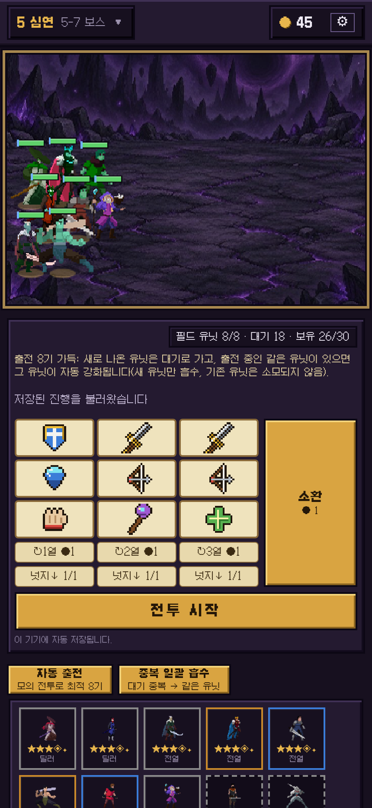
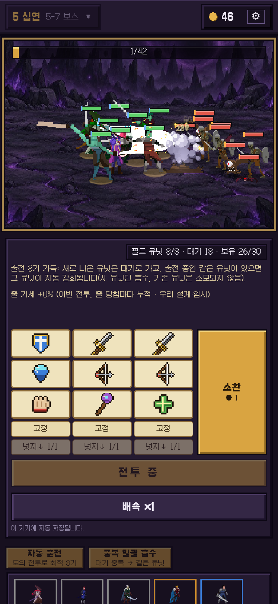
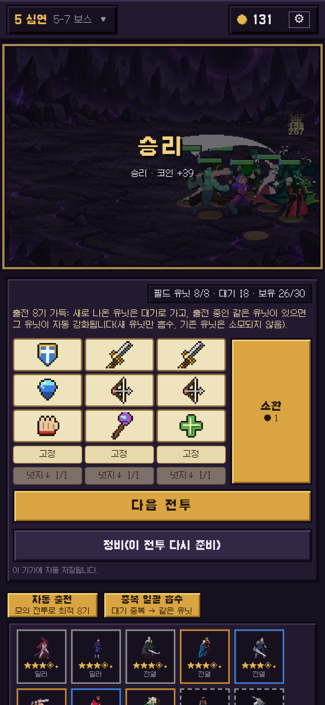
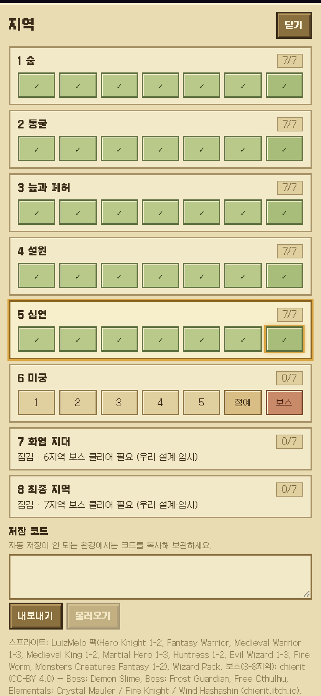
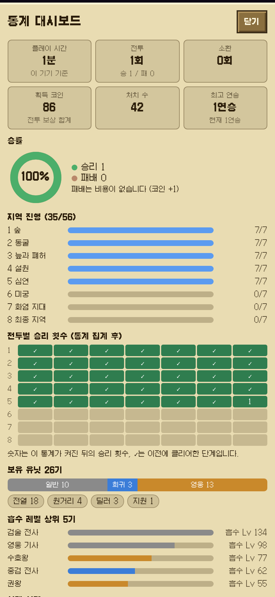

# 소환 기사단 (Summon Knights)



3x3 슬롯으로 유닛을 소환하고, 자동으로 싸우는 전투에서 이겨 성장시키는 모바일 우선 웹 게임입니다. 슬롯 소환 + 자동전투 성장 장르를 참고해 직접 만든 창작물이며, 원작의 코드나 에셋은 사용하지 않았습니다. 현재 개발중이며 임시 요소는 화면에 "개발중·임시"로 표시됩니다.

## 플레이

- 플레이(GitHub Pages): https://sigco3111.github.io/summon-knights/
- 미러(Instinct Files): https://files.instinct.com/45t9ymtwk2hf
- 저장소: https://github.com/sigco3111/summon-knights

진행은 브라우저에 자동 저장됩니다. 저장이 지원되지 않는 환경(Files 미러 등)에서는 지역 메뉴의 "저장 코드"로 내보내고 불러오세요.

## 주요 기능

- **슬롯 소환**: 3x3 슬롯을 돌려 줄을 맞추면 유닛과 보상을 얻습니다. 열 고정, 넛지로 당첨을 노릴 수 있습니다.
- **자동 전투**: 출전 8기가 자동으로 싸웁니다. 배속 조절과 자동 출전, 자동 진행 옵션이 있습니다.
- **8개 지역 x 7전투 = 56전투**: 지역마다 일반 5, 정예 1, 보스 1. 지역 보스를 넘기면 다음 지역이 열립니다.
- **성장**: 중복 유닛 흡수, 강화, 승급, 각인, 승리 보상으로 고르는 코어와 강화. 보유 한도(30기)에서는 당첨을 잃지 않도록 보류합니다.
- **난이도 3단계**: 쉬움, 노멀, 하드. 패배에는 비용이 없고 코인 1개를 받습니다.
- **엔딩과 회차**: 8-7 보스를 넘으면 임시 엔딩 패널이 뜨고, 유닛과 코어를 유지한 채 다음 회차를 시작할 수 있습니다(적이 더 강해짐).
- **통계 대시보드**: 설정(⚙)과 엔딩 패널에서 열 수 있습니다. 플레이 시간, 전투 승패와 승률, 소환 수, 획득 코인, 처치 수, 최고 연승, 지역별 진행, 전투별 승리 횟수, 유닛 구성, 흡수 레벨 상위 유닛을 보여 줍니다.

## 스크린샷

| 전투 | 결과 | 지역 지도 | 통계 대시보드 |
| --- | --- | --- | --- |
|  |  |  |  |

## 설치와 실행

플레이만 하려면 위 링크를 열면 됩니다. 소스에서 빌드하려면 Node.js가 필요합니다.

```bash
npm install react react-dom esbuild
npx esbuild src/main.tsx --bundle --minify --format=iife --jsx=automatic \
  --alias:@instinct/files=./build/stub.ts \
  --loader:.png=dataurl --loader:.jpg=dataurl --loader:.woff2=dataurl --loader:.webp=dataurl \
  --define:process.env.NODE_ENV='"production"' --outfile=dist/bundle.js
cp docs/index.html dist/index.html
sed -i 's#bundle[.0-9a-f]*\.css#bundle.css#; s#bundle[.0-9a-f]*\.js#bundle.js#' dist/index.html
npx http-server dist   # 또는 아무 정적 서버로 dist/ 폴더를 열기
```

`@instinct/files`(Files 미러용 저장소)는 `build/stub.ts`(브라우저 localStorage)로 대체해 빌드합니다. `docs/`는 GitHub Pages가 서비스하는 배포본입니다.

## 기술 노트

- React + TypeScript, 전투는 Canvas, 번들은 esbuild.
- 게임 규칙과 수치는 `src/game.ts`, 화면은 `src/App.tsx`, 통계 대시보드는 `src/dash.tsx`.
- 저장은 단일 키(`slotbound.save.v1`)에 JSON으로 저장하며, 통계는 같은 저장에 `stats` 필드로 들어갑니다.
- 통계는 이 기능이 들어간 빌드부터 집계합니다. 그 이전의 전투 수, 소환 수, 획득 코인, 처치 수는 기록되지 않았습니다.
- 흡수, 승급, 각인, 회차 배율 등 "우리 설계·임시"로 표시된 규칙은 직접 설계한 값이며 정식 밸런스 검증 전입니다.
- Files 미러(files.instinct.com)는 저장소를 지원하지 않는 환경이라 자동 저장이 되지 않습니다(알려진 제약). 그곳에서는 저장 코드를 사용하세요.
- 실제 모바일 기기 터치는 개발 환경에서 직접 시험하지 못했습니다(모바일 폭 430px 화면만 확인).

## 라이선스와 출처

- 코드: 라이선스 파일은 아직 지정하지 않았습니다(개발중, 소유자가 정합니다).
- 캐릭터 스프라이트: LuizMelo 팩(Hero Knight 1-2, Fantasy Warrior, Medieval Warrior 1-3, Medieval King 1-2, Martial Hero 1-3, Huntress 1-2, Evil Wizard 1-3, Fire Worm, Monsters Creatures Fantasy 1-2), Wizard Pack. 해당 페이지에 CC0로 명시되어 있습니다.
- 보스 스프라이트(3~8지역): chierit(chierit.itch.io), CC-BY 4.0. Boss: Demon Slime, Boss: Frost Guardian, Free Cthulhu, Elementals: Crystal Mauler / Fire Knight / Wind Hashashin.
- 배경: 8개 지역 모두 AI로 생성한 쿼터뷰 전장 배경입니다.
- 글꼴: Galmuri11. 원작 게임의 코드와 에셋은 사용하지 않았습니다.
